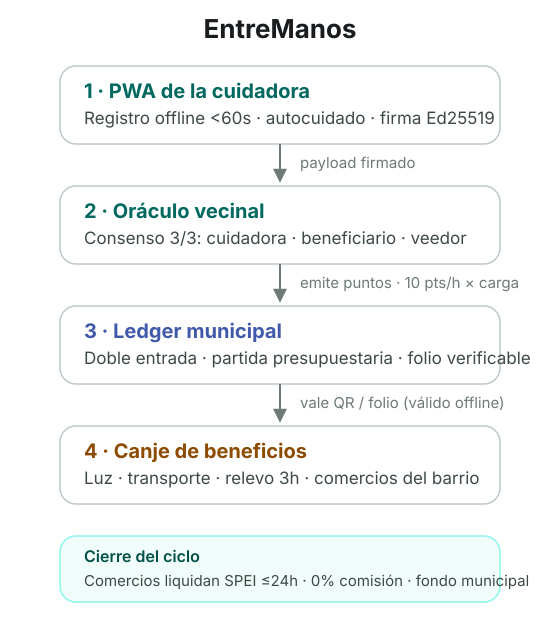

# EntreManos — Civic Care Network

**[Español](README.md)** · *Cuando cuidas, te descuidas.* Specs and monorepo
for civic infrastructure that
certifies informal care hours and turns them into **Civic Points** redeemable
for real benefits: electricity subsidies, public transit, certified respite
hours and neighborhood merchants.

> "When you care, you neglect yourself." The platform exists so that caring
> does not cost caregivers their health: points are also earned for self-care.

The caregiver — the "sandwich generation", ~38, mostly women — logs a shift in
under 60 seconds, fully offline. A neighborhood oracle validates it 3-of-3
(caregiver + beneficiary + community verifier) and points are issued, backed
by municipal budget lines. Every public dollar returns ~3.42x in measurable
social value (SROI).

<picture>
  <source media="(prefers-color-scheme: dark)" srcset="docs/assets/flow-dark.svg">
  
</picture>

## Project status

Working monorepo with all six surfaces implemented as a demo: the PWA logs
and redeems offline, the merchant terminal verifies the Ed25519-signed voucher
and charges it, the government panel computes SROI, and the services
marketplace covers the full request lifecycle. `packages/domain` holds the
shared math (points, consensus, SROI, catalog). Reference screens exported
from the prototype live in `design/stitch/`.

Live demos:

- Landing: <https://g10hdz.github.io/entremanos/>
- Time bank (sign in as Ana or Luis): <https://g10hdz.github.io/entremanos/app/>
- Government panel: <https://g10hdz.github.io/entremanos/gobierno/>
- 79-second walkthrough video: <https://github.com/G10hdz/careledger/releases/tag/demo-2026-11-07>

These are a static build of `main` at `059ba55`, served from GitHub Pages
([G10hdz/entremanos](https://github.com/G10hdz/entremanos)). The main domain,
<https://entremanos-mx.vercel.app>, still shows the previous version because
Vercel hit its limit of 100 deployments a day.

The app is named **EntreManos**; the program is *Cuando cuidas, te
descuidas*. Internal identifiers keep the `careledger` slug: `@careledger/*`
packages, the `careledger://` scheme, storage keys and the repository name.

## Layout

See `README.md` (Spanish) — structure is identical. Entry points:
`specs/` (source of truth), `packages/domain`, `packages/design-tokens`,
`docs/explainer.html` (single-file project overview, also on GitHub Pages).

## Quick start

Requires Node 22+, pnpm 9+.

```bash
pnpm install
pnpm -r test
pnpm -r typecheck
```

## License

[MIT](LICENSE)
