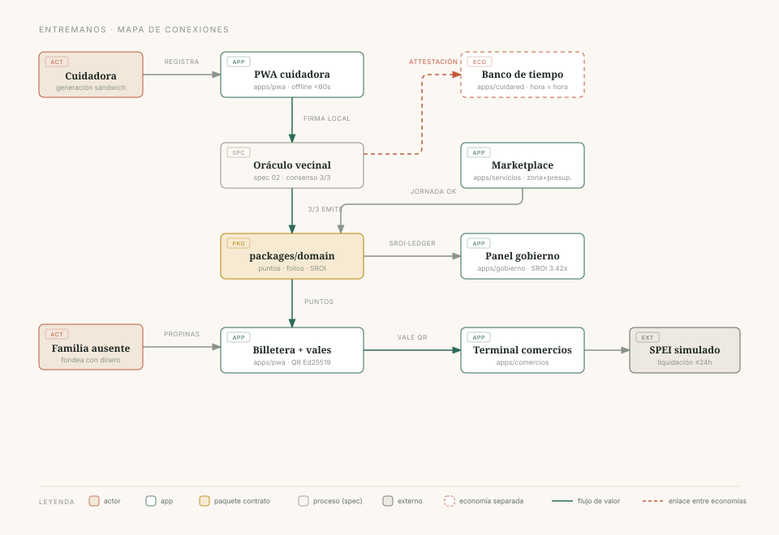

# EntreManos

**[English](README.en.md)** · Cuando cuidas, te descuidas. Especificación y
monorepo de una infraestructura cívica que certifica horas de cuidado informal
y las convierte en **Puntos Cívicos** canjeables por beneficios reales: luz,
transporte, horas de relevo y comercios del barrio.

> La plataforma existe para que cuidar no te cueste la salud: también se
> ganan puntos por autocuidado.

La cuidadora (la "generación sándwich", ~38 años, mayoría mujeres) registra su
jornada en menos de 60 segundos, sin internet. Un oráculo vecinal valida
3-de-3 — cuidadora, beneficiario y veedor comunitario — y se emiten puntos
respaldados por presupuesto municipal. Cada peso invertido retorna ~3.42x en
valor social medible (SROI).

<picture>
  <source media="(prefers-color-scheme: dark)" srcset="docs/assets/flow-dark.svg">
  
</picture>

<picture>
  <source media="(prefers-color-scheme: dark)" srcset="docs/assets/arch-dark.svg">
  
</picture>

## Estado del proyecto

Monorepo funcional con las seis superficies implementadas como demo: la PWA
registra y canjea offline, la terminal de comercios verifica el vale con
firma Ed25519 y cobra, el panel de gobierno calcula el SROI, y el marketplace
de servicios cubre el ciclo de solicitud completo. `packages/domain` concentra
la matemática compartida (puntos, consenso, SROI, catálogo). Las pantallas de
referencia exportadas del prototipo están en `design/stitch/`.

Demos en vivo:

- Landing (sitio público): <https://entremanos.vercel.app>
- Explainer: <https://g10hdz.github.io/careledger/>
- CuidaRed (prototipo del banco de tiempo, spec 09):
  <https://g10hdz.github.io/careledger/cuidared/>

La app se llama **EntreManos**; el programa es "Cuando cuidas, te
descuidas". Los identificadores internos conservan el slug `careledger`:
paquetes `@careledger/*`, esquema `careledger://`, claves de almacenamiento
y el nombre del repositorio.

## Estructura

```
specs/            fuente de verdad: 00 plataforma → 09 banco de tiempo + roadmap
design/           DESIGN.md (sistema) + stitch/ (pantallas de referencia)
docs/             documento fuente, ADRs, spike antifraude, assets, Pages
apps/             pwa, gobierno, comercios, landing, servicios, cuidared
packages/
  domain/         tipos + puntos + consenso + SROI + catálogo (contrato)
  design-tokens/  tema Tailwind v4 "Civic Care & Human Dignity"
docs/explainer.html   explicación del proyecto en un solo archivo
```

## Lo mínimo

Requisitos: Node 22+, pnpm 9+.

```bash
pnpm install
pnpm -r test        # tests del dominio (vitest)
pnpm -r typecheck   # tsc estricto
```

Abrir `docs/explainer.html` en el navegador para el panorama completo, o
https://g10hdz.github.io/careledger/ (GitHub Pages).

## Desarrollo en paralelo

El repo está pensado para varios agentes a la vez: cada superficie vive en su
`apps/<territorio>` y se trabaja en su propio worktree de git. Los contratos
compartidos (`packages/domain`, `packages/design-tokens`) solo se extienden,
no se reescriben. Reglas completas en `AGENTS.md`.

## Privacidad

Nunca se suben nombres de pacientes, diagnósticos ni fotos. La atestación
transporta duración, categoría, tipos de apoyo y firmas; la ubicación se usa
como prueba de proximidad agregada, no como tracking.

## Licencia

[MIT](LICENSE)
